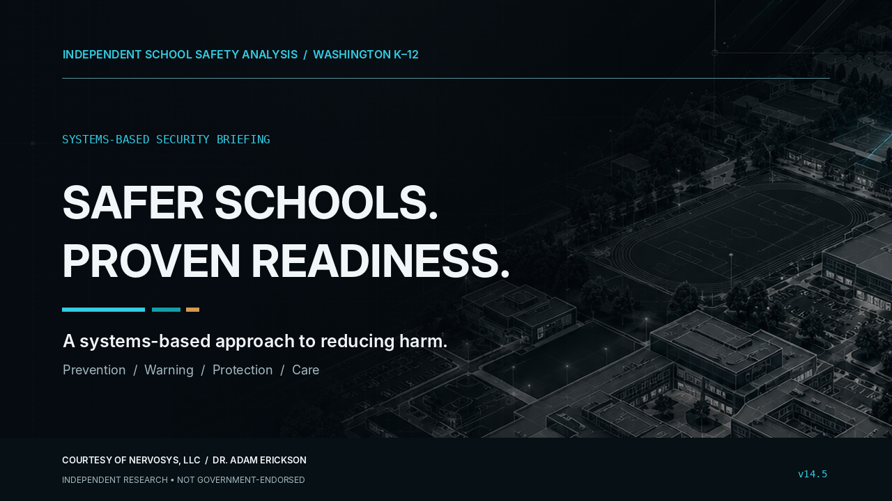

# School Threat Mitigation

[](LICENSE)

Public-facing Washington school-safety advisory and video briefing, prepared courtesy of **NERVOSYS, LLC**.

This release contains an independent recommendations report, a concise executive summary, a proposal for a national school-safety innovation forum, and a narrated video. It is *not* a government publication, site-specific security assessment, or proof that an institution has implemented these practices.

## Published materials

| Deliverable | Version | Location |
|---|---|---|
| School Safety Field Guide | 14.5 | [`docs/advisory-v14.5/School_Safety_Field_Guide_VERSION_14_5.pdf`](docs/advisory-v14.5/School_Safety_Field_Guide_VERSION_14_5.pdf) |
| Executive Summary | 14.5 | [`docs/advisory-v14.5/Executive_Summary_VERSION_14_5.pdf`](docs/advisory-v14.5/Executive_Summary_VERSION_14_5.pdf) |
| National School Safety Innovation Forum | 14.5 | [`docs/advisory-v14.5/National_School_Safety_Innovation_Forum_VERSION_14_5.pdf`](docs/advisory-v14.5/National_School_Safety_Innovation_Forum_VERSION_14_5.pdf) |
| Final narrated briefing | 14.6 | [`media/final/WA_School_Safety_Kokoro_am_michael_v14_6.mp4`](media/final/WA_School_Safety_Kokoro_am_michael_v14_6.mp4) |
| Narration master | 14.6 | [`media/final/Kokoro_Narration_am_michael_v14_6.wav`](media/final/Kokoro_Narration_am_michael_v14_6.wav) |
| Synchronized captions | 14.6 | [`media/final/Kokoro_Captions_am_michael_v14_6.srt`](media/final/Kokoro_Captions_am_michael_v14_6.srt) |



## Build the Kokoro narration on Windows

Install [uv](https://docs.astral.sh/uv/), [FFmpeg](https://ffmpeg.org/) and [eSpeak NG](https://github.com/espeak-ng/espeak-ng). The Kokoro model and dependencies are downloaded on first use; model weights are not committed here.

Open a terminal in `media/production/` and run:

```powershell
uv run --python 3.12 .\kokoro_uv_render.py --check
uv run --python 3.12 .\kokoro_uv_render.py
```

Or double-click `media/production/RUN_ON_WINDOWS_UV.cmd`. The default voice is `am_michael`, an American-English male voice at 0.92× speed. Output goes to `media/production/output/` and is ignored by Git. The committed final video/audio were supplied by the publisher and are not regenerated by this packaging step.

## Edit advisory documents

The three editable Typst and HTML versions, common CSS files, cover image, build script, and publication QA report reside in `docs/advisory-v14.5/`. Run `bash build_pdfs.sh` from that folder after installing Typst to compile the Typst source. HTML/CSS sources are included for alternate publishing workflows. Version 14.5 uses 0.75-inch body margins.

## Security and privacy

Please read [`SECURITY.md`](SECURITY.md) and [`PRIVACY_AUDIT.md`](PRIVACY_AUDIT.md) **before publishing new documents or accepting contributions**. Do not commit personally identifying student information, maps of protected facilities, unpublished operational plans, access codes, credentials, or private correspondence. Run:

```bash
python scripts/privacy_check.py
```

A baseline audit was completed on the supplied Version 14.6 release. That check cannot guarantee the absence of all sensitive information, particularly content added later.

## License

**GNU Affero General Public License v3.0 only**, `AGPL-3.0-only`, to the extent each rights-holder may grant it. See [`LICENSE`](LICENSE) and [`NOTICE.md`](NOTICE.md). The Kokoro model and third-party software are not redistributed or relicensed.

## Release integrity

`SHA256SUMS.txt` lists the SHA-256 checksums for all files in this release except the checksum manifest itself. To check from the repository root on Linux/macOS:

```bash
sha256sum -c SHA256SUMS.txt
```
