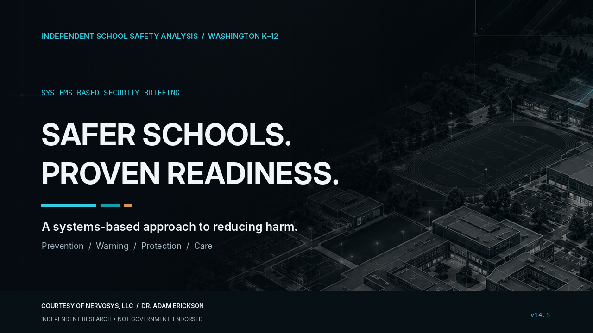

# SchoolThreatMitigation -- Rust implementation



*Original Version 14.5 briefing artwork. Current documents are Version 17.0 Revision 1; protective readiness still requires independent review.*

The 0.4.0 RC10 implementation is Rust throughout its supported software workflow. It provides a versioned school-safety knowledgebase, 18 logical advisory rules over 42 Boolean facts, deterministic assessments, proof replay, read-only MCP, evaluation, review packets, privacy checks, and release tooling. No Python interpreter, Python package installation, or Python SDK is required.

The public research scope remains 18 scenarios and 15 proposed controls. The inherited 56-hazard register remains publication material. This software does not authenticate assertions, certify legal compliance, authorize deployment, predict individuals, or control security equipment.

## Published documents

Current publications: **Version 17.0 Revision 1**. Each document is available as a PDF and an editable HTML source.

| Document | PDF | HTML source |
| --- | --- | --- |
| School Safety Field Guide | [PDF](docs/advisory-v17.0-r1/School_Safety_Field_Guide_V17_0_R1.pdf) | [HTML](docs/advisory-v17.0-r1/School_Safety_Field_Guide_V17_0_R1.html) |
| Threat Scenario and Countermeasure Engineering | [PDF](docs/advisory-v17.0-r1/Threat_Scenario_and_Countermeasure_Engineering_V17_0_R1.pdf) | [HTML](docs/advisory-v17.0-r1/Threat_Scenario_and_Countermeasure_Engineering_V17_0_R1.html) |
| Executive Decision Brief | [PDF](docs/advisory-v17.0-r1/Executive_Decision_Brief_V17_0_R1.pdf) | [HTML](docs/advisory-v17.0-r1/Executive_Decision_Brief_V17_0_R1.html) |
| Ninety-Day Qualification Pilot | [PDF](docs/advisory-v17.0-r1/Ninety_Day_Qualification_Pilot_V17_0_R1.pdf) | [HTML](docs/advisory-v17.0-r1/Ninety_Day_Qualification_Pilot_V17_0_R1.html) |
| Constitutional Governance and Public Trust | [PDF](docs/advisory-v17.0-r1/Constitutional_Governance_and_Public_Trust_V17_0_R1.pdf) | [HTML](docs/advisory-v17.0-r1/Constitutional_Governance_and_Public_Trust_V17_0_R1.html) |
| Threat-Driven Technology and AI | [PDF](docs/advisory-v17.0-r1/Threat_Driven_Technology_and_AI_V17_0_R1.pdf) | [HTML](docs/advisory-v17.0-r1/Threat_Driven_Technology_and_AI_V17_0_R1.html) |

Version 17.0 briefing: [PowerPoint slides](media/v17.0/SchoolThreatMitigation_Briefing_V17_0.pptx) · [PDF](media/v17.0/SchoolThreatMitigation_Briefing_V17_0.pdf).

Machine-readable references: [scenario register](governance/threat_scenarios_v17_0.json) · [control requirements](governance/control_requirements_v17_0.json) · [scenario-to-control mapping (CSV)](governance/threat_to_countermeasure_v17_0.csv).

## Build and check

```text
cargo fetch --locked --manifest-path engine/Cargo.toml
cargo build --locked --release --manifest-path engine/Cargo.toml --bins
cargo test --locked --manifest-path engine/Cargo.toml --all-targets
engine/target/release/stm-tool check
```

On Windows, use `engine\BUILD_WINDOWS.cmd`, `engine\RUN_WINDOWS.cmd`, `engine\TOOL_WINDOWS.cmd`, and `engine\CHECK_WINDOWS.cmd`. The check wrapper stages the tool outside Cargo's output before invoking Cargo checks, avoiding Windows executable locks. Use the `.exe` suffix when invoking native paths directly on Windows.

Two binaries are produced: `stm-neurosymbolic` is the advisory engine and MCP server; `stm-tool` provides verification, agent hosting, evaluation, review, privacy, and release commands. Run either with `--help`. Cargo dependencies are locked; offline builds work after they are cached.

The initial fetch caches the entire locked dependency graph for offline SBOM generation, including dependencies for other platforms. A host-only build can leave those packages uncached. CI performs this [all-target prefetch](https://doc.rust-lang.org/cargo/commands/cargo-fetch.html) before its native checks.

## Verified assessments

```text
stm-tool bridge --root TRUSTED_SOURCE --trusted-manifest-sha256 SOURCE_PIN --binary TRUSTED_ENGINE --trusted-executable-sha256 ENGINE_PIN < engine/examples/district_aggregate.json
stm-tool verify-proof --root TRUSTED_SOURCE --trusted-manifest-sha256 SOURCE_PIN --request REQUEST.json --assessment ASSESSMENT.json
```

The bridge verifies both artifacts before launch, accepts only approved anonymous Boolean assertions, bounds subprocess input/output and time, and checks the complete response with a separately implemented Rust interpreter. Neither the checker nor agent prose can approve evidence or institutional use. Missing facts remain unknown. Default reasoning dates remain frozen to the KB reference date.

## Project references

- [Agentic workflow instructions](AGENTS.md) and [sanitized engine-guided test results](qa/agentic/2026-11-01/README.md)
- [Engine and native workflow](engine/README.md)
- [Reasoning semantics](engine/docs/REASONING_CONTRACT.md)
- [Host integration](engine/docs/AGENT_INTEGRATION.md)
- [Trust and rollback](engine/docs/RELEASE_TRUST.md)
- [Privacy boundaries](engine/docs/PRIVACY_BOUNDARIES.md)
- [Evaluation](engine/docs/RETRIEVAL_EVALUATION.md)
- [Independent review](engine/docs/INDEPENDENT_REVIEW.md)
- [Implementation status](docs/IMPLEMENTATION_STATUS.md) and [completion plan](docs/IMPLEMENTATION_PLAN.md)
- Current publications: `docs/advisory-v17.0-r1/`; briefing: `media/v17.0/`.

Publication R1 predates this software migration. Its references to a cross-language checker are superseded by the current Rust guides and [errata](docs/PUBLICATION_ERRATA.md). Publication contents and prior visual QA are preserved rather than silently relabeled.

The Python-era 0.3 tools and evidence remain in retained historical archives. They are excluded from the 0.4 supported source distribution and current workflow. No optional cross-language test is run. Current local results are recorded in `qa/implementation_validation.json`; independent review, clean-machine/selected-host acceptance, signing/distribution policy, and release approval remain pending. Code and editable sources retain AGPL-3.0-or-later licensing and existing source attribution.

The explicit UxS, automatic teargas and self-sealing hallway proposals are documented in [countermeasure proposal coverage](engine/docs/COUNTERMEASURE_PROPOSALS.md). These are review-only records: autonomous chemical release, weaponized UxS and automatic confinement/detention are blocked, not implemented as actuators.

## Security audit — 31 October 2026

The latest [maintainer security audit](qa/security_audit_2026_10_31.json) checked all 202 lockfile packages against 1,395 advisories in a freshly downloaded [RustSec database](https://github.com/RustSec/advisory-db), revision `2295466c4e9df26647fd67d8fa1c705ac2fc7f81`. It reported zero matching vulnerabilities or warnings, with no ignored advisories or target/severity filters. Frozen license/source-policy checks reported zero errors or warnings. Yanked-package status was not checked.

The local Windows run passed 67 Rust tests, formatting and warning-denied lint, including proof replay, MCP rejection and restart behavior, archive integrity, subprocess limits and privacy regressions. Gitleaks found no secrets in the public Git candidate or existing repository history. Native Rust privacy inspection also covered the current source inventory and the 13 historical publication files outside that inventory. These automated checks do not establish absence of unknown vulnerabilities, private information in image pixels, or legal license compatibility.

This commit includes an audit and documentation refresh of RC10, with Git-stable source bytes and refreshed manifests. The archived RC10 packages and their original qualification records remain historical evidence bound to their original hashes; they are not relabeled as qualification of this refreshed source snapshot. Build and verify the current checkout using its own `RELEASE_MANIFEST.json` and `SHA256SUMS.txt`. Local build caches, raw diagnostics and generated `output/` artifacts are excluded from Git.

The accountable owner remains **TBD**, and all ten Gate A acceptance gates remain pending. Independent source, rule, privacy, accessibility, dependency, release and host reviews are still required. No independent acceptance, authenticated release distribution or deployment authorization is claimed.
