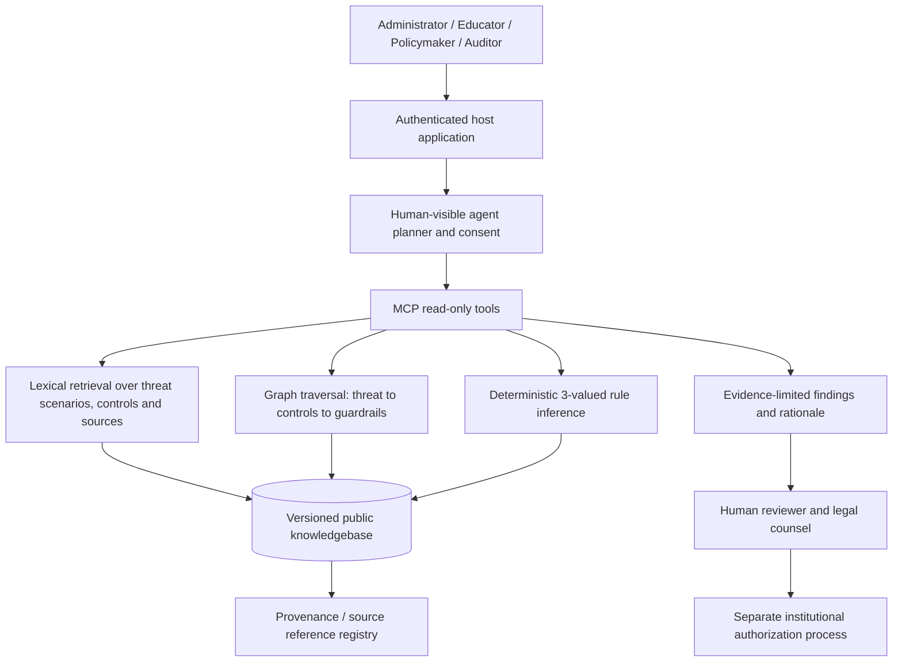

# Architecture — Public, Evidence-Grounded Neuro-Symbolic Reasoning

## Mission

Deliver a reproducible recommendation and compliance-support knowledge system addressing school mass-shooting prevention and consequence mitigation. Center the human roles: administrators decide implementation, educators review accessible guidance, policymakers compare policy and evidence, auditors challenge safety claims and due-process compliance.

## High-level structure

**Only read-only MCP tools are supplied.** Neither the model nor the Rust engine can update institutional policy, alert dispatch, control doors, assess individual students, or authorize force. These are hard architectural boundaries, not optional prompt instructions.

## Knowledge domains

1. Unauthorized youth firearm access — voluntary education, secure storage, and no school ownership registry.
2. Behavioral threat assessment — behavior/context/corroboration instead of demographic profiling; no punitive decision solely from a referral.
3. Detection/verification — provenance, realistic false-positive and missed-event testing, independent evaluation.
4. Protective environments — accessibility, code-compliant egress, secure but non-trapping barriers.
5. Specialist capabilities — qualified canine evaluation and professional response governance without tactical instruction.
6. Medical, incident coordination and recovery — bleeding control, staff training, continuity and family reunification.
7. Cyber-physical safety — adversarial input, compromised alerts, ransomware, vendor access, secure fallback.
8. Constitutional oversight — due process, student records, complaint channels, anti-retaliation and independent review.
9. Adaptive technology and AI — threat-driven pilots, model monitoring, no autonomous adverse action or force.

Each threat scenario carries an evidence classification, verification method, owner, metric, rights gate, and stop condition. Edges link it to a proposed control and appropriate governance rules. These edges are **hypotheses and traceability links**, not proof of intervention effectiveness.

## Authority and symbolic logic

- `statutory_reference`: conditionally applicable official-law checks. The engine never treats them as automatically binding on every district; lawyers must review the live statutes, exceptions and local facts.
- `safety_guardrail`: proposed non-negotiable technical/public-trust requirements. A false predicate yields `deployment_hold` as an engineering advisory.
- `deployment_qualification`: tests needed before piloting or deploying particular technologies.
- `voluntary_recommendation`: proposals that must not be relabeled statutory obligations.

The predicate language is deliberately small: `fact == boolean`, with `AND` across all `when` and `check` predicates. The outcome is three-valued:

| When/applicability | Required predicate evidence | Outcome |
| --- | --- | --- |
| Definitively false | — | `not_applicable` |
| Unknown | — | `scope_unknown` |
| True | Some unknown; no false | `needs_evidence` |
| True | All asserted true relative to rule | `evidence_indicates_satisfied` |
| True | Some false | `gap_for_review` |
| True, safety guardrail | Some false | `deployment_hold` |

"False" means a **mismatch to the required value**, not merely the fact being a Boolean false. No negative finding is made from missing evidence. No final legal compliance determination is ever returned.

The engine currently accepts only anonymous Boolean self-attestations (e.g. `annual_security_agreement_reviewed: false`). A future authorized evidence verifier must ingest document hashes, approval dates, official citations, scope/tenant data, signer credentials and expiration dates via a separate secure subsystem before these results can be considered reliable.

## Agentic interaction: design boundary

The engine's built-in agent mode is deterministic: Planner → Retriever → Verifier → Human-review prompt. Real neural natural-language capabilities come from a separately hosted LLM or enterprise agent using MCP. The AI can choose read-only tools and explain citations but cannot control what the symbolic rules evaluate to.

Required external-agent protections: tool allowlisting; prompt-injection isolation; signed versions of rules; no transmission of PII or sensitive campus layouts to a public model; provenance-aware explanation; user-visible tool calls; approved fact collection; policy/legal sign-off.

## Threat-model assumptions

The reasoning process itself may be attacked. Consider injected source documents, adversarial user questions, false fact submissions, compromised dependencies, poisoned rule updates, hallucinated citations, and attempts to infer private firearm ownership or demographic characteristics. Protections are mandatory: immutable release contents, constrained predicates, no live external fetches, no mutable tools, logging metadata rather than personal inputs, human source review, independent red-team evaluations and rollback.

## Production development roadmap (not yet implemented)

**Phase I:** Harden read-only core; compile/test on stable Rust; signed knowledge versions; document traceability and confidence. **Phase II:** Enterprise SSO with ABAC tenant isolation and independent admin/legal reviewer roles; encrypted institution-hosted evidence vault; retention and appeals; vetted updates from official sources. **Phase III:** Retrieval-augmented LLM using public-only records by default, offline/local models for sensitive work, adversarial testing, calibrated uncertainty and incident recovery simulations. **Phase IV:** Secure site-specific integrations only after legal, accessibility, fire-code, cyber and independent evaluation gates; keep commands to life-safety equipment and force outside the recommendation engine.

## Deployment constraints

No claimed authorization to operate a school-security system or make legal determinations. Site-specific vulnerability details belong in restricted repositories, not GitHub. For emergency situations, users follow locally adopted plans and emergency-service procedures; this engine is not an emergency-response channel.
